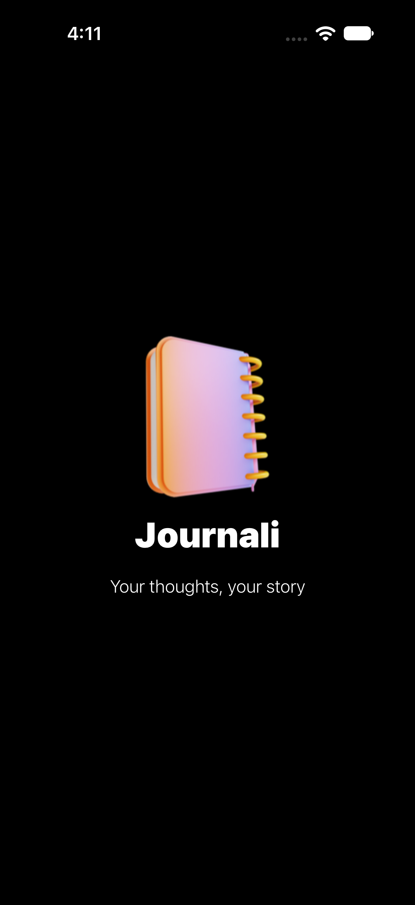
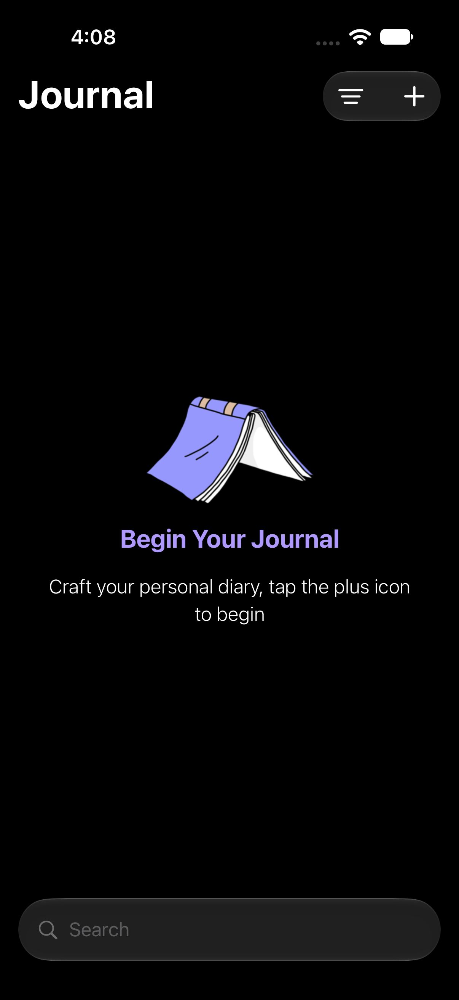
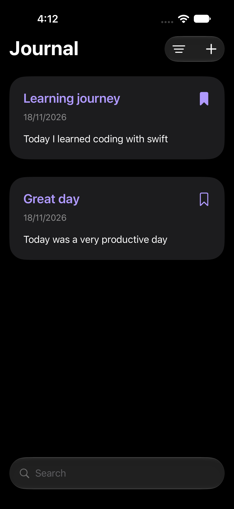
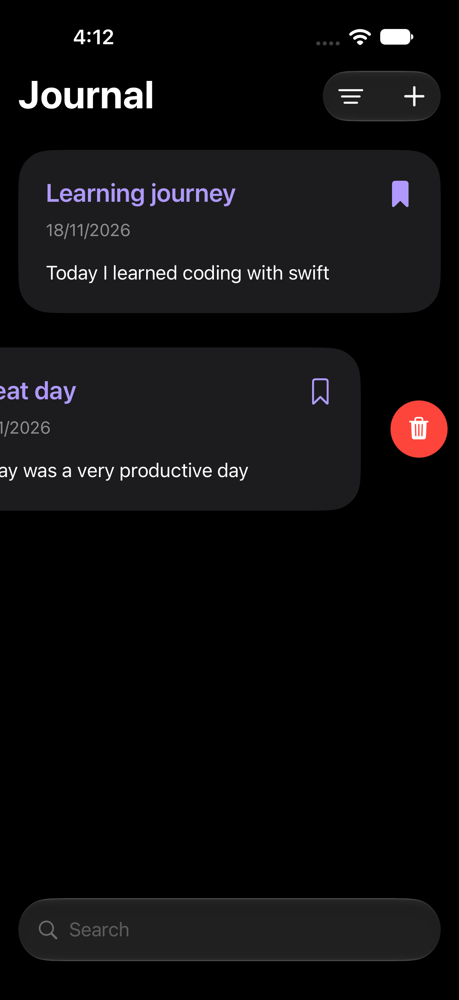
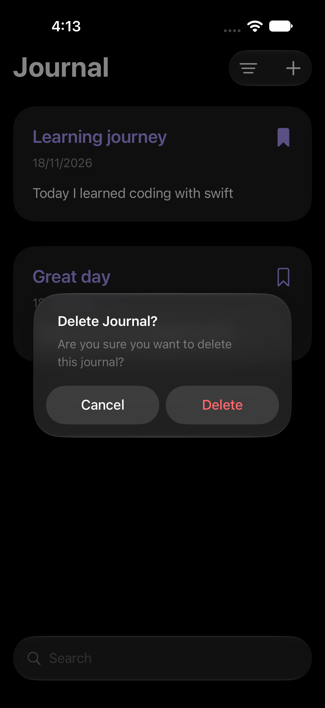

# 📓 Journali

Journali is a simple journaling app for iPhone.
It lets you write down your daily thoughts, then easily find, edit, and bookmark them.

---

## Main Features

- **Write a journal** with a title and content
- **Edit** any journal by tapping on it
- **Delete** a journal by swiping left, with a confirmation alert
- **Bookmark** your favorite journals
- **Search** journals by title
- **Sort** journals by entry date or by bookmark
- **Discard alert** that asks before closing unsaved changes
- **Empty state** screen when there are no journals yet
- **Splash screen** when the app opens

---

## Screenshots

<p>
  
  
  
</p>
<p>
  
  
  
</p>

---

## Technologies Used

- **Swift**
- **SwiftUI**
- **MVVM** architecture
- **Xcode 26** / **iOS 26**

---

## Project Structure

```
Journali
├── Model
│   └── Journal.swift            → Journal data + sort options
├── View
│   └── ContentView.swift        → All app screens
├── ViewModel
│   └── JournalViewModel.swift   → Add, edit, delete, search, sort
└── MyApp.swift                  → App entry point
```

---

## Developer

**shahad aljuhani**
GitHub: [@https://github.com/shahadsoj2-a11y]
